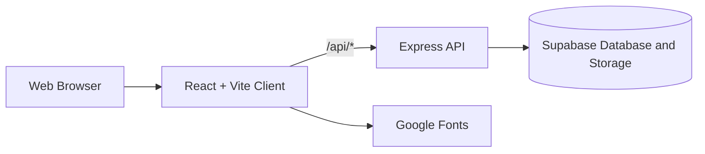
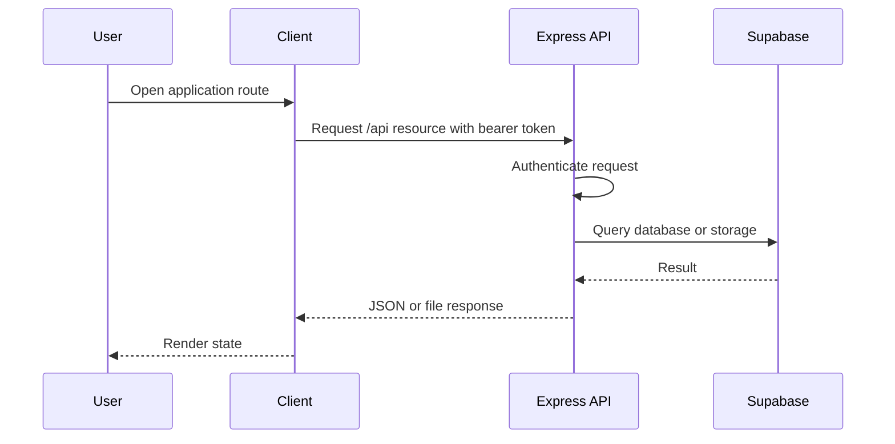

# Architecture

## System Context

## Components

### Client

Location: `client/`

- React 19 renders the application screens.
- Vite provides local development and production bundling.
- `client/src/main.jsx` mounts the React application.
- `client/src/app/App.jsx` owns the route switch.
- `client/src/features/` contains route screens grouped by product area.
- `client/src/shared/components.jsx` contains reusable layout and UI primitives.
- `client/src/shared/lib/` contains navigation and service integrations.
- `client/src/styles/` contains global and application styles.
- Client-side routing currently uses the History API and `popstate`.

### Server

Location: `server/`

- `server/src/index.js` loads environment values and starts the HTTP listener.
- `server/src/app.js` configures Express middleware, routes, and error handling.
- `server/src/config/` owns service configuration.
- `server/src/middleware/` owns request middleware such as authentication.
- `server/src/routes/` owns the HTTP API endpoints.
- `server/supabase/` contains the database schema.
- Express exposes the `/api` route group.
- Helmet provides baseline security headers.
- CORS is enabled for client access.
- Supabase is the persistence and storage provider.
- Authentication middleware validates bearer tokens before protected routes.

### Deployment

`vercel.json` defines two Vercel services:

- `client`: the public Vite application
- `server`: the Express API, exposed through `/api/*`

There are currently no service bindings because the client and server do not make internal service-to-service requests through private hostnames.

## Request Flow

## Boundaries

- The client owns presentation, input state, navigation, and optimistic interaction only.
- The server owns authentication, authorization, validation, credit mutations, and persistence.
- Supabase credentials remain server configuration. The browser must not receive the service role key.
- Any future client-to-service URL should use a public `/api` path or a declared Vercel binding, never a hardcoded localhost or deployment hostname.